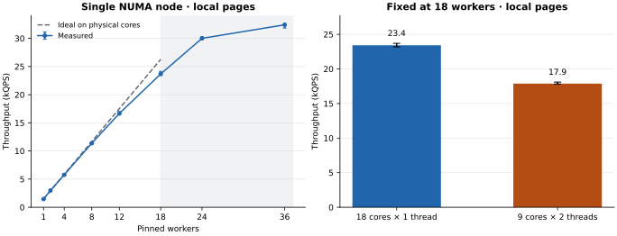
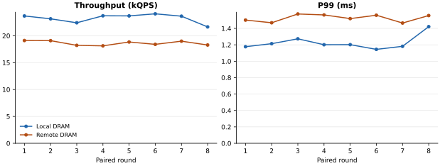
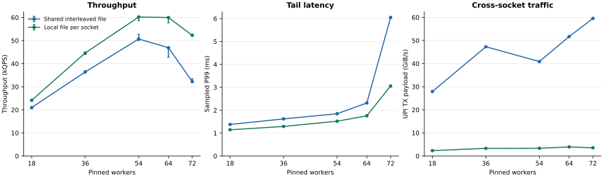

# CPU 还有空闲，HNSW 的 QPS 为什么涨不动？

给一个 1.57 GiB 的只读 HNSW 索引压测时，我把查询线程从 24 加到 36。CPU 用量涨了约一半，吞吐却只从 3.00 万涨到 3.24 万 QPS。P99 还变差了，从 1.31 ms 升到 1.75 ms。看整机指标，约 47% 的逻辑 CPU 时间仍处于空闲或 I/O 等待。

这台机器有两颗 CPU，每颗有 18 个物理核。查询线程全绑在第一颗。跑到 24 线程时，已经有 6 个核各跑两个查询线程。加到 36 时，这颗 CPU 上每个核都跑两个线程。此时第二颗 CPU 的空闲核仍然算在整机指标里。

于是我把问题拆成两步。先在一个 NUMA 节点内看两个查询线程共享一个物理核的代价，再看把线程分到两颗 CPU 后，索引页放在哪里会改变结果。

## 用完 18 个物理核之后

我先让查询线程和索引页都待在同一个 NUMA 节点。加到 8 个线程时，吞吐是单线程的 7.8 倍。到 18 个线程，每个物理核各跑一个查询，吞吐达到 16.2 倍。再往上加线程，新增查询开始和已有查询共享物理核。下图左边那条曲线在这里弯了下去。

光看这条曲线，线程数和绑核方式一起变了。于是我固定 **18 个查询线程**，做了图右边的对照。先让每个线程独占一个物理核，再把同样的 18 个线程挪到 9 个核上，每核两个线程。索引页留在原处，两组都消耗了约 17.8 个逻辑 CPU 的运行时间。第二组却只跑出 17,873 QPS，第一组是 23,412 QPS。换个绑法，吞吐少了 **24%**。 [单路扩展数据](results/primary.jsonl) · [固定线程数的绑核数据](results/smt.jsonl)

这也解释了开头为什么 CPU 用量能涨得比吞吐快。同一物理核上的两个 SMT 线程同时运行时，系统会把它们各自的运行时间计入不同的逻辑 CPU，它们仍然共享这个核的执行资源。在 24 到 36 线程之间，完成一条查询执行的指令几乎没变，花掉的 CPU 时间却从 790 增至 1,093 µs。

还有一个容易看反的指标。单路从 18 加到 36 线程，每条查询退休的 L3 未命中加载数从约 2,950 降到 1,719。与此同时，PEBS 采样到的本地 DRAM 加载，其使用延迟中位数从 217 升到 349 周期。一次 HNSW 遍历要读邻接表，再根据读到的内容决定往哪走。看这类负载时，数有多少加载未命中和看这些加载要等多久，是两件事。这里的使用延迟还包含流水线排队。 [L3 事件定义](https://perfmon-events.intel.com/platforms/cascadelakex/core-events/core/) · [PEBS 样本](results/pebs-summary.csv) · [perf mem 指标说明](https://man7.org/linux/man-pages/man1/perf-mem.1.html)

## 线程搬过去了，索引页还在原地

接着我用了第二颗 CPU。为了看远端读的代价，我把索引页留在 node 0，用 18 个物理核搜索。每对跑两次，一次把线程绑在 node 0，一次绑在 node 1。单轮跑 20 秒，下一对倒过来跑，避免总是由同一组先跑。八对结果里，远端组每次都更慢。本地与远端的吞吐中位数分别是 23,662 和 18,622 QPS。按对计算，远端吞吐少了 **19.5%**，P99 多了 **25.2%**，这里用的是八对变化幅度的中位数。两组的估算运行频率都约为 2.50 GHz。 [逐对结果](results/review/numa-pairs.csv) · [运行记录](results/review/numa-long.jsonl)

在这台机器上，一个 NUMA 节点对应一个插槽。node 1 的核要读 node 0 的 DRAM，就得经过两颗 CPU 之间的 UPI 链路。远端组的整机 UPI 流量从约 0.9 升到 21.8 GiB/s，两组估算的后台 CPU 用量都在每路 1–1.4 个逻辑核之间。 [计数器汇总](results/review/summary.csv)

上面这组也换了执行查询的插槽。接下来我固定 54 个线程的绑核列表，把它们均匀分在两路，只改索引页的位置。原先所有页都在 node 0，几乎全部 DRAM 读流量也集中在那里。把索引页交错分到两个节点后，两边的读流量接近了，吞吐从 **36,966 升到 47,502 QPS**。交错放页缓解了单节点的流量集中，但两边的线程仍会读到对方节点上的页。 [集中与交错放页数据](results/topology.jsonl)

## 每路各放一份索引

既然线程已经按 NUMA 节点分好了，能不能让每一边都从本地读？两组都在每路使用一个 Index 对象，绑核和预留的查询上下文数量也相同。一组的两个对象映射同一份交错放页的文件，另一组各自映射一份字节相同的本地副本。两边仍然各查完整的图。这一步多占约 1.57 GiB 的索引文件页。 [文件校验和](results/replica-sha256.txt) · [逐轮数据](results/replicas.jsonl)

72 线程时，这个改动最明显。吞吐从 **3.23 万升到 5.23 万 QPS**，P99 从 **6.05 降到 3.06 ms**。同时，整机 UPI 数据流量从 59.5 降到 3.6 GiB/s，查询进程每条查询退休的远端 DRAM 加载数也从约 1,085 降到 21。一个计数器在链路上，另一个跟着查询进程，两者都看到了远端读大幅减少。 [汇总数据](results/summary.csv) · [Intel UPI 事件定义](https://perfmon-events.intel.com/platforms/cascadelakex/uncore-events/uncore/)

## 双路都读本地以后，72 线程还是慢了

图里还有一个拐点。本地副本在 **54 线程**时已经做到 **6.02 万 QPS，P99 1.52 ms**。加到 64 线程，吞吐基本持平，P99 升到 1.76 ms。再加到 72 线程，吞吐掉到了 5.23 万 QPS。

这个下跌是不是短时间的波动？我把窗口拉到 12 秒，交替跑了四对 54 和 72 线程。四对里，72 线程的吞吐降幅在 3.0% 到 14.5% 之间，P99 每次都更高。两档的估算运行频率都约为 2.50 GHz，查询线程每秒被非自愿切换出去的次数中位数却从 113 增到约 11,750。整机空闲与 I/O 等待合计也只剩约 0.1%。 [四对长测](results/review/replica-long.jsonl)

我也检查了 USearch 管理查询上下文的两次加锁。每个查询开始时领取一个槽位，结束后归还。我在诊断版里每 257 条查询计时一次。72 线程的本地副本组，两次加锁合计占采样查询总耗时约 **0.05%**。五种配置里占比最高的是 54 线程的交错放页组，约 **1.05%**。这组此前也做过固定槽位对照，绕过共享槽池前后分别为 49,485 和 47,531 QPS。两组证据让我把排查重心放回访存和调度。 [槽位计时](results/review/slot-audit.jsonl) · [固定槽位对照](results/slots.jsonl)

UPI 流量在这组长测里维持在约 3 GiB/s，增长的是本地读流量和等待时间。72 线程时，两路 DRAM 合计约读到 172 GiB/s。另一组 PEBS 采样里，本地 DRAM 加载的使用延迟从约 232 升到 355 周期。同机顺序读参考约为 215 GiB/s，两种访问模式能达到的带宽不同。固定线程数的绑核对照已经测到了物理核共享的代价；这里同时看到访存变慢和调度抢占增加，还需要分别量化它们对回落的贡献。 [PEBS 样本](results/pebs-summary.csv) · [顺序读参考](results/bandwidth-reference.csv)

我想看看，给同一节点的内存加点压力，查询会慢多少。让 18 个搜索线程和索引都留在 node 0，另外在 node 1 绑 8 个线程，反复顺序读取一个 1.5 GiB 的缓冲区。缓冲区放在 node 1 时，查询跑出 24,174 QPS，和无后台读取时的 23,641 QPS 接近。把缓冲区移到 node 0，查询降到 21,712 QPS，比读另一节点时少约 **10%**，P99 从 1.17 ms 升到 1.32 ms。三轮结果都是同一方向。

查询仍然读本地索引，但两个负载用到了同一节点的内存控制器。此时 node 0 的 DRAM 读流量约为 62 GiB/s，UPI 数据流量也升到了约 36 GiB/s。这组干预测到了共享访存路径的影响。把这部分损失分到内存控制器和互连上，需要分别控制两处的流量。 [内存干扰逐轮数据](results/review/pressure.jsonl)

## 换一批查询，拐点还在吗？

前面的请求循环使用了 1,000 条查询。重复搜索相近的路径，可能会改变缓存里的内容。我保持索引不动，从训练分片中取出建图范围之后的 16,384 条向量，再用其中前 1,000 条做一组对照。两个查询池都用同样的 8 秒窗口，每个 NUMA 节点各加载一份查询向量。 [1,000 条留出查询](results/review/heldout-1000.jsonl) · [16,384 条留出查询](results/review/heldout-16384.jsonl)

| 查询集 | 54 线程 QPS | 72 线程 QPS | 54 线程 P99 | 72 线程 P99 |
| --- | ---: | ---: | ---: | ---: |
| 原始 1,000 条 | 59,805 | 55,172 | 1.48 ms | 2.56 ms |
| 留出 1,000 条 | 66,585 | 56,537 | 1.32 ms | 2.53 ms |
| 留出 16,384 条 | 51,029 | 53,083 | 1.74 ms | 2.74 ms |

大查询池让吞吐的结论变了。留出查询从 1,000 条扩大到 16,384 条后，54 线程时每条查询的退休指令数仍约为 122 万，但整机 DRAM 读流量从约 55 升到 171 GiB/s。此时 72 线程比 54 线程多约 **4%** 的吞吐，P99 却高约 **58%**。54 线程在这三组里都更有利于尾延迟，吞吐最高的并发度则随查询集而变。 [复测汇总](results/review/summary.csv)

再遇到「CPU 还有空闲，QPS 已经不涨」时，我会先核对线程共享了哪些物理核，再确认它们读的索引页落在哪个 NUMA 节点。找到一组看起来合适的并发后，还要换成接近实际流量的查询集，看看吞吐和尾延迟的取舍是否一样。

## 复现实验

机器有两颗 Xeon Gold 6240，每个插槽对应一个 NUMA 节点。索引用 USearch 2.25.3 建成，包含 VectorDBBench LAION 的 524,288 条 768 维 float32 向量，使用平方 L2。图连接度为 16，建图扩展参数 128，查询扩展参数 64。查询返回 top‑10，原始 1,000 条测试查询的 Recall@10 为 96.41%。 [机器配置](results/host.txt) · [召回率校验](results/accuracy.txt) · [VectorDBBench](https://github.com/zilliztech/VectorDBBench)

每个 Rust 线程绑到指定逻辑 CPU，直接调用 `Index::search`，循环重放给定查询集。上一条返回后才发下一条，P99 计的是闭环调用从发起到返回的时间。固定到达率下的服务排队是另一种测量口径。索引映射在计时前预读，用 `/proc/self/numa_maps` 核对页位置。补测也在计时结束后核对了一次。

早期并发扫描每个配置跑三次，每次 1.75–2.5 秒，图中的吞吐误差线标出最小值和最大值。配对复测采用八对 20 秒窗口，记录每四条查询中的一条延迟。每轮本地组与远端组分别有约 11.8 万和 9.3 万条延迟样本（中位数）。PEBS 报告达到 30 周期门槛的加载样本。双路本地副本的补测使用四对 12 秒窗口，留出查询使用三对 8 秒窗口，内存干扰对照每种配置使用三个 8 秒窗口。机器上还有其他服务，内存控制器和 UPI 计数包含整机流量。 [复现步骤](README.md) · [逐配置汇总](results/summary.csv)
