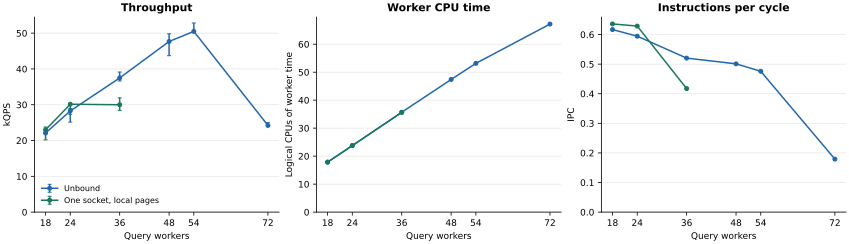
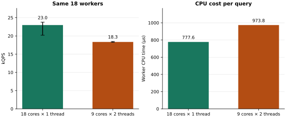

# CPU 还有空闲，HNSW 的 QPS 为什么涨不动？

我拿一个包含 524,288 条向量记录的只读 HNSW 索引做压测。整个索引提前载入内存，查询直接调用 USearch 的 Rust API。每个线程发起一次搜索，等结果回来，再发下一次。起初没有绑核，让操作系统决定线程在哪里运行。

线程少的时候，吞吐随着并发增加，事情看起来很正常。到了 48 个线程，大约能跑 4.77 万 QPS。加到 54 个，CPU 用量增加了约 12%，QPS 却只多了约 6%。继续加到 72 个，查询消耗的 CPU 时间从相当于 53.2 个逻辑 CPU 增到 67.2 个，吞吐反而掉到 2.42 万 QPS。

机器明明还在花更多 CPU 时间，同一秒里完成的查询却变少了。我想先弄清楚，这些时间花到哪里去了。

我把 perf stat 接到压测进程上，先看指令数和周期数。按每条完成的查询折算，几档并发执行的指令都在 123 万条左右。变的是执行这些指令用掉的周期。54 线程时，IPC 约为 0.48；到 72 线程，只剩 0.18。每条查询消耗的 CPU 时间也从约 1.05 ms 涨到 2.77 ms。

采集核心计数的命令如下。程序通过 FIFO 在预热结束后启用计数，搜索窗口结束后关闭计数。这段保留了这次采集的事件和控制方式，另一路整机 IMC、UPI 采集由复现脚本负责。

```bash
# 后面的 perf_search 命令在同一个 Bash 会话中执行
perf_search() (
  probe_dir=$(mktemp -d)
  trap 'rm -rf "$probe_dir"' EXIT
  mkfifo "$probe_dir/control" "$probe_dir/ack"

  events='cycles:u,instructions:u,mem_load_retired.l3_miss:u'
  events+=',mem_load_l3_miss_retired.local_dram:u'
  events+=',mem_load_l3_miss_retired.remote_dram:u'
  events+=',ref-cycles:u,cpu-migrations,context-switches'

  sudo -n perf stat -x, --delay=-1 \
    --control="fifo:$probe_dir/control,$probe_dir/ack" \
    -e "$events" -- \
    sudo -n -u "$USER" -- env \
      HNSW_PERF_FIFOS="$probe_dir/control,$probe_dir/ack" \
      HNSW_LATENCY_STRIDE=4 "$@"
)

for threads in 54 72; do
  perf_search ./target/release/hnsw-scaling bench \
    data/laion-524288.usearch data/queries.f32 \
    shared 64 "unbound:$threads" 12 2
done
```

下文的 perf stat 输出都节选自第一轮的原始 CSV，三轮趋势可以从完整记录核对。每行开头是事件总数，第三列是事件名，100.00 表示该事件在启用期间全程得到计数。注释里的 completed 来自同一轮压测输出。曲线和前文的概括数值采用三轮中位数，下面对原始输出的计算则按该轮的 completed 折算。 [完整运行记录](results/story/scaling.jsonl)

```text
# 54 个线程，压测程序报告 completed=606624
1568998381878,,cycles:u,644495169450,100.00,,
746683365066,,instructions:u,644495169450,100.00,0.48,insn per cycle
421295087,,mem_load_l3_miss_retired.local_dram:u,644495169450,100.00,,
253612881,,mem_load_l3_miss_retired.remote_dram:u,644495169450,100.00,,

# 72 个线程，压测程序报告 completed=291184
2002014396811,,cycles:u,813759448845,100.00,,
358470712074,,instructions:u,813759448845,100.00,0.18,insn per cycle
539624230,,mem_load_l3_miss_retired.local_dram:u,813759448845,100.00,,
320717331,,mem_load_l3_miss_retired.remote_dram:u,813759448845,100.00,,
```

把 54 线程那轮的 746,683,365,066 条指令除以 1,568,998,381,878 个周期，得到 IPC 约 0.48。再除以该轮完成的 606,624 条查询，每条约 123 万条指令。72 线程那轮也约为每条 123 万条指令，但 IPC 已降到约 0.18。远端 DRAM 加载总数也按各轮完成的查询数折算，才能比较单次查询的访存成本。

这里的 IPC 是每个周期退休的指令数。CPU 一直在运行，也可能因为等数据、争用执行资源而完成不了多少指令。看到 IPC 掉下去，我开始看访存计数。72 线程时，每条查询退休的远端 DRAM 加载约有 1,104 次，54 线程时约为 418 次。光靠这些数还难以判断每部分开销，但远端访问给了我一个可以动手验证的方向。 [这轮 perf 汇总](results/story/summary.csv) · [Intel 事件定义](https://perfmon-events.intel.com/platforms/cascadelakex/core-events/core/)

这台机器有两颗 Xeon Gold 6240，每颗 18 个物理核，开启了超线程，每个物理核提供两个逻辑 CPU。整机有 72 个逻辑 CPU，两个 socket 各对应一个 NUMA 节点。

不绑核时，查询确实运行在两边。我在采样查询结束时记录它所在的节点，再检查索引映射的页位置。结果是两路都有线程在查，索引页却仍在 node 0。文件是在之前准备索引时读入内存的，后来把查询线程分到另一颗 CPU，页并没有跟过去。

这就有了一个很具体的怀疑。node 1 上的线程要读 node 0 的 DRAM，必须经过两颗 CPU 之间的 UPI 链路。HNSW 又会沿着图里的邻接关系不断访问节点，一些后续访问要等前面读到邻居信息后才能决定。沿途多出来的等待，可能会在一次搜索里反复出现。

于是我把查询线程都绑到 node 0，也把新分配的查询数据和临时空间留在 node 0，重新增加并发。索引、查询集和搜索参数都沿用刚才那一组。

18 个线程时约为 2.30 万 QPS。加到 24 个，涨到 3.01 万。再加到 36 个，CPU 用量从相当于 23.8 个逻辑 CPU 增到 35.6 个，吞吐却停在约 3.00 万 QPS。P99 则从 1.28 ms 升到 1.91 ms。



绿色曲线就是单 socket 的结果。它在 24 个线程之后也弯了下去。此时每条查询退休的远端 DRAM 加载已低于 0.02 次，远端读大幅减少了，CPU 增长却没换来吞吐增长的现象仍然在。

我又回到 perf。这次只比较单路的 24 和 36 个线程。每条查询的指令数仍然约为 123 万，估算运行频率也都在 2.50 GHz 左右，但 IPC 从 0.63 降到了 0.42，每条查询花掉的 CPU 时间从约 789 µs 增到 1,188 µs。

这次沿用前面的 perf_search，只把工作线程列表和内存策略换成单路。逻辑 CPU 0–17 分别属于这一侧的 18 个物理核，36–53 是它们的超线程兄弟。

```bash
cpus24="$(seq -s, 0 17),$(seq -s, 36 41)"
cpus36="$(seq -s, 0 17),$(seq -s, 36 53)"

for cpus in "$cpus24" "$cpus36"; do
  perf_search numactl --physcpubind=0 --membind=0 \
    ./target/release/hnsw-scaling bench \
    data/laion-524288.usearch data/queries.f32 \
    shared 64 "$cpus" 12 2
done
```

下面仍摘取第一轮输出，同时列出参考周期，方便核对运行频率。

```text
# 单路 24 线程，completed=364880
707442210644,,cycles:u,287624500594,100.00,,
449134244090,,instructions:u,287624500594,100.00,0.63,insn per cycle
554772700,,mem_load_retired.l3_miss:u,287624500594,100.00,,
2973,,mem_load_l3_miss_retired.remote_dram:u,287624500594,100.00,,
735814731496,,ref-cycles:u,287624500594,100.00,,

# 单路 36 线程，completed=383568
1061759199087,,cycles:u,431172928492,100.00,,
472197244003,,instructions:u,431172928492,100.00,0.44,insn per cycle
484794322,,mem_load_retired.l3_miss:u,431172928492,100.00,,
3062,,mem_load_l3_miss_retired.remote_dram:u,431172928492,100.00,,
1104366214640,,ref-cycles:u,431172928492,100.00,,
```

第一轮里，指令数除以 completed，两档都是每条约 123 万条指令。周期数除以 completed，却从每条约 194 万增到 277 万。远端 DRAM 加载分别只有每条约 0.0081 和 0.0080 次。核心周期与参考周期的比值乘以这台机器的 2.60 GHz 参考频率，两档都约为 2.50 GHz。查询的工作量、频率和远端读都对齐后，增加并发带来的单次查询成本仍然清晰可见。

还有一个起初不太容易理解的变化。每条查询退休的 L3 未命中加载数，从约 1,520 次降到了 1,264 次。未命中更少，查询却更贵了。我想知道，那些仍然需要等内存的加载，究竟等了多久，于是另外跑了几组 perf mem。

我把慢加载采样单独跑了一遍，避免把采样开销混进前面的吞吐窗口。下面展示一轮采样的命令，只采用户态加载，延迟门槛设为 30 个周期，每轮预热 2 秒，再采 5 秒。perf script 输出每个样本的延迟权重和数据来源。

```bash
(
  probe_dir=$(mktemp -d)
  trap 'rm -rf "$probe_dir"' EXIT
  mkfifo "$probe_dir/control" "$probe_dir/ack"

  for threads in 18 36; do
    cpus="$(seq -s, 0 17)"
    if [ "$threads" -eq 36 ]; then
      cpus="$cpus,$(seq -s, 36 53)"
    fi

    HNSW_PERF_FIFOS="$probe_dir/control,$probe_dir/ack" \
      perf mem record -t load -U --ldlat 30 -c 10007 \
      --delay=-1 --control="fifo:$probe_dir/control,$probe_dir/ack" \
      -o "$probe_dir/perf-$threads.data" -- \
      numactl --physcpubind=0 --membind=0 \
      ./target/release/hnsw-scaling bench \
      data/laion-524288.usearch data/queries.f32 \
      shared 64 "$cpus" 5 2

    perf script -i "$probe_dir/perf-$threads.data" -F weight,data_src
  done
)
```

每个配置重复三轮后，用仓库的 summarize.py 按数据来源汇总。下面是 RAM hit，也就是本地 DRAM 样本的统计，p50_cycles 和 p95_cycles 的单位都是周期。

```text
label,rep,source,samples,p50_cycles,p95_cycles
local-18,1,RAM hit,299,217,535
local-18,2,RAM hit,387,218,655
local-18,3,RAM hit,260,216.5,637
local-36,1,RAM hit,206,319.0,849
local-36,2,RAM hit,224,307.5,869
local-36,3,RAM hit,180,331.0,997
```

18 线程的三轮 P50 都在 217 个周期附近，36 线程则在 308–331 个周期。三轮变化方向一致。与前面的 L3 未命中计数合起来看，剩下的慢加载花了更多时间，同时每条查询消耗的 CPU 周期也增加了。这种加载使用延迟包含流水线排队，尚不能把额外的等待都归给 DRAM 硬件本身。 [这轮慢加载采样](results/story/pebs-summary.csv) · [perf mem 指标说明](https://man7.org/linux/man-pages/man1/perf-mem.1.html)

这时再看硬件拓扑，24 到 36 个线程跨过的边界就很明显了。这一路只有 18 个物理核。跑到 24 个线程，已有 6 个核各跑两个查询线程；到 36 个线程，每个物理核都在跑两个。新增的查询开始和已有查询共享同一颗核里的资源。

CPU 使用率按逻辑 CPU 统计，两个超线程可以同时贡献运行时间。一个物理核的执行单元和缓存却要由它们共同使用。线程数增加，操作系统能记下更多忙碌时间，每个查询分到的执行能力也可能随之变化。

为了把这个因素单独拿出来，我固定 18 个查询线程。一组分到 18 个物理核上，每核一个线程；另一组只用 9 个物理核，每核两个线程。索引页仍在 node 0，两组也都消耗了约 17.9 个逻辑 CPU 的运行时间。

这组对照仍然使用相同的 perf 事件，只换线程对应的逻辑 CPU 列表。第二组中，0 和 36、1 和 37 等各是一对超线程兄弟。

```bash
cpus18="$(seq -s, 0 17)"
cpus9smt='0,36,1,37,2,38,3,39,4,40,5,41,6,42,7,43,8,44'

for cpus in "$cpus18" "$cpus9smt"; do
  perf_search numactl --physcpubind=0 --membind=0 \
    ./target/release/hnsw-scaling bench \
    data/laion-524288.usearch data/queries.f32 \
    shared 64 "$cpus" 12 2
done
```

```text
# 18 个物理核，每核 1 个线程，completed=276080
534315926425,,cycles:u,216051773587,100.00,,
339841112408,,instructions:u,216051773587,100.00,0.64,insn per cycle

# 9 个物理核，每核 2 个线程，completed=222064
534038146516,,cycles:u,216001482382,100.00,,
273347666103,,instructions:u,216001482382,100.00,0.51,insn per cycle
```

这轮两组的周期总数都约为 5,340 亿，完成的查询却从 276,080 条降到 222,064 条。每条查询的指令数仍约为 123 万，IPC 从约 0.64 降到了 0.51。同样多的查询线程花掉了接近的 CPU 时间，集中到更少物理核后，每秒完成的工作变少了。

前一组约为 22,986 QPS，后一组约为 18,349 QPS，少了约 20%。线程数相同，索引和查询相同，仅仅把线程集中到一半的物理核上，就付出了这笔代价。



这样，单 socket 上的曲线就多了一层解释。前半段增加线程，更多物理核参与了搜索；后半段继续增加线程，查询开始分享已经在忙的物理核。把两段都画在“并发数”这个横轴上，看起来只是多开了几个线程，底下的资源分配已经变了。

单路里的拐点有了线索，我再回头核对双路的远端读。此前还有一组更直接的对照，把索引页固定在 node 0，用同样数量的 18 个物理核搜索，只改变线程所在的 socket。八对交替运行的 20 秒窗口里，读远端内存的那组每次都更慢，吞吐的配对中位降幅为 19.5%。 [本地与远端读对照](results/review/numa-pairs.csv)

沿着这个方向，还可以给每路各放一份完整的本地图。我也测过这组只读副本的对照。两边都查完整索引，额外占用约 1.57 GiB 内存。在此前固定绑核的双路对照中，72 线程的吞吐从交错放页时的 3.23 万升到 5.23 万 QPS，UPI 数据流量也从约 59.5 降到 3.6 GiB/s。页的位置确实值得调整，同时还要留意线程共享了哪些物理核。 [本地副本对照](results/replicas.jsonl)

72 线程还有一个额外的条件。它占用了整机全部逻辑 CPU，而机器上的其他服务也要运行。这轮不绑核测试里，查询线程的非自愿上下文切换从 54 线程时每秒约 139 次，升到 72 线程时约 8,218 次。双路曲线的最后一段包含了共享机器上的调度竞争。要精确分出它造成了多少吞吐损失，还需要把后台负载隔离开来做对照。 [逐配置计数](results/story/summary.csv)

做到这里，我也开始谨慎对待“最佳并发数”这几个字。前面的压测反复使用同一份 1,000 条查询。把查询池换成 16,384 条留出查询后，在双路本地副本配置下，72 线程反而比 54 线程多了约 3.3% 的吞吐。搜索的图没变，平均访问的图节点数和距离计算次数也很接近，缓存计数却明显变了。 [查询集与搜索工作量对照](results/followup/summary.csv) · [遍历计数](results/followup/query-work.csv)

吞吐略高的同时，P99 从 1.72 ms 升到了 2.83 ms。假设给这份闭环压测划一条 2 ms 的 P99 预算，在这两档并发中，54 线程仍然更合适。换一份查询负载，或者换一个延迟要求，并发设置就需要重新测。

回到开头，整机 CPU 还有空闲，只能算排查的起点。先看线程实际跑在哪些物理核上，再看这些核读的是哪一边的页。缩到单路后，如果吞吐仍然进入平台，就继续比较每条查询的指令、周期和访存等待，用固定线程数的对照检查共享资源的代价。

这次最值得记住的，是同一张全内存 HNSW 图，在不同的线程和数据摆法下，会呈现出很不一样的扩展曲线。NUMA 放置、超线程和查询工作集都参与其中。最后要选哪档并发，得把实际查询负载下的吞吐和尾延迟放在一起看。

---

本文的新测试都在 10.2.12.79 上复用同一份 USearch 2.25.3 索引。它包含 524,288 条 768 维 float32 向量，使用平方 L2，连接度 16，建图扩展参数 128，查询扩展参数 64，返回 top-10。原始 1,000 条测试查询的 Recall@10 为 96.41%。新吞吐扫描每个配置运行三次，每次计时 12 秒、预热 2 秒，每四次查询采一条延迟。图中吞吐误差线表示三轮的最小值和最大值。 [原始运行记录](results/story/scaling.jsonl) · [召回率校验](results/accuracy.txt)

不绑核入口保留完整的 CPU 亲和性范围，单路入口明确绑定 node 0。两组都在计时前预读索引，并在计时前后检查页位置。30 个长窗口的进程存储读取计数均为 0。机器上的其他服务照常运行，72 个查询线程会和它们争用 CPU，这部分影响也包含在曲线里。内存控制器和 UPI 计的是整机流量。本文的 P99 是同步闭环调用延迟，线上服务还需要测实际到达率下的排队时间。完整命令和更细的诊断结果放在复现说明里。 [复现步骤](README.md)
